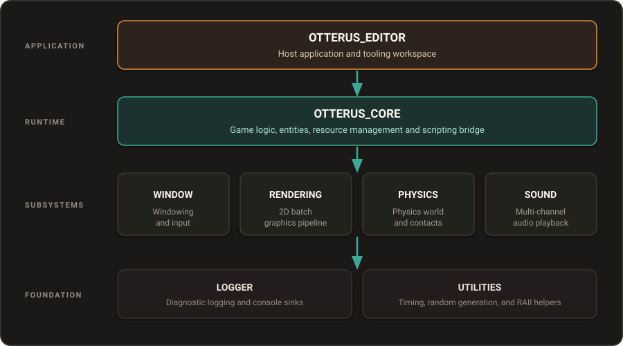

About Otterus2D
===============

Welcome to **Otterus2D**, a modern 2D game engine built from the ground up with C++20, modern OpenGL 4.5 Core profile, and Lua 5.3 scripting.

----

Core Philosophy
---------------

Otterus2D is designed around four key principles:

1. **Entity-Component-System (ECS)**:
   Powered by `EnTT <https://github.com/skypjack/entt>`_, game logic and scene data are strictly decoupled. Components are Plain Old Data (POD) structures, and systems process batches of cache-friendly components linearly.

2. **Clean Layered Architecture**:
   The engine strictly enforces a one-way dependency graph. Low-level modules (``OTTERUS_RENDERING``, ``OTTERUS_PHYSICS``, ``OTTERUS_SOUND``, ``OTTERUS_WINDOW``) are self-contained static libraries that never include higher-level modules or editor code.

3. **High-Performance 2D Renderer**:
   Utilizes OpenGL 4.5 Core with batch rendering, modern GLSL shaders, TrueType font rendering, and off-screen Framebuffer Objects (FBO) displayed within the Dear ImGui editor viewport.

4. **Rapid Lua Iteration**:
   Through Sol3 bindings, gameplay scripts can be created and reloaded on the fly without recompiling C++ binaries.

----

Documentation Organization
--------------------------

This documentation is structured following the **Diataxis framework**, categorizing technical knowledge into four distinct areas:

* :doc:`../tutorials/getting_started`: Hands-on walkthrough to create your first playable entity with input and sound.
* :doc:`../architecture/engine_overview`: Deep dive into subsystem boundaries, frame lifecycles, and main-thread execution.
* :doc:`../reference/ecs_components`, :doc:`../reference/lua_api`, and :doc:`../reference/asset_manager`: Authoritative API specifications and component data dictionaries.
* :doc:`../how-to/handle_collisions` and :doc:`../how-to/play_audio_sfx`: Targeted problem-solving recipes.
